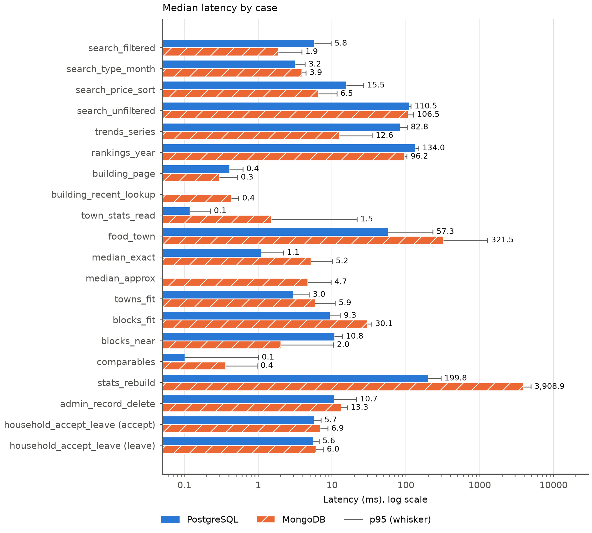
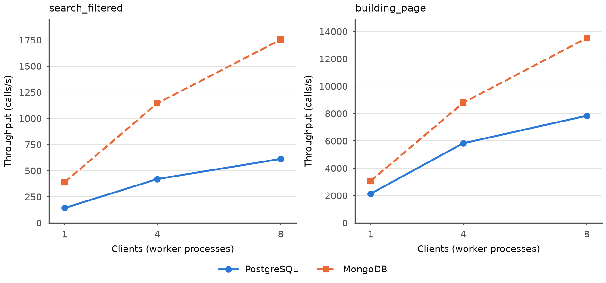
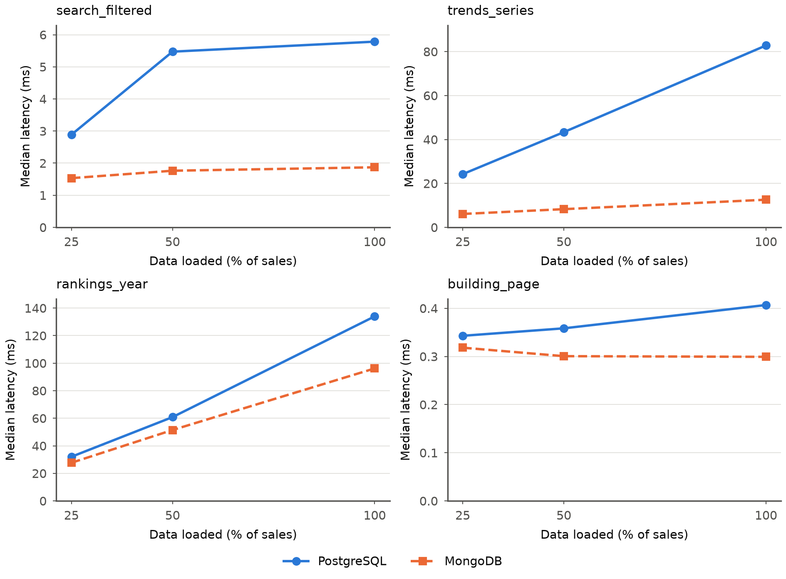
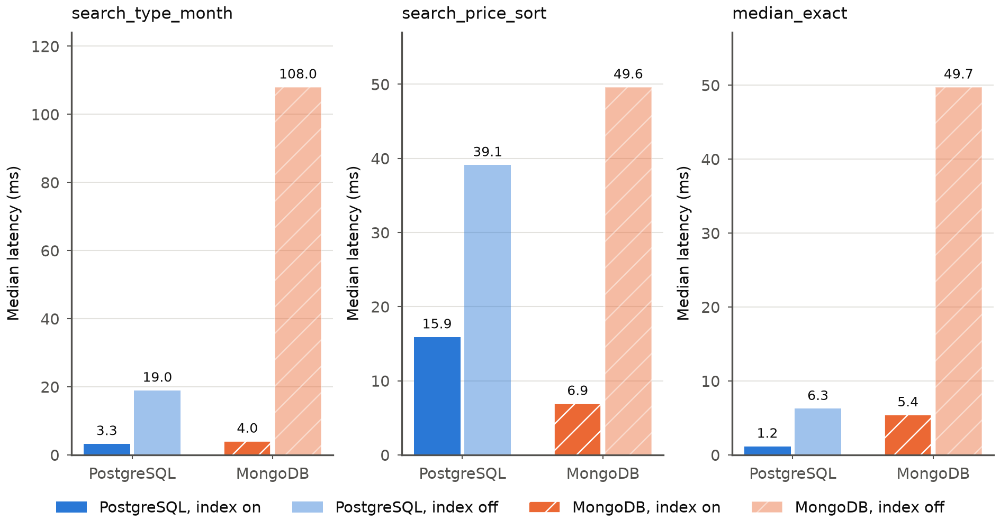

# Benchmark results, 2026-11-rerun

Every number in this file is generated from the committed `summary.csv`, `throughput.csv`, `index_on_off.csv`, `scaling.csv` and `env.json` files in this folder tree; none is typed by hand. The raw timings are in `f100/raw.jsonl` (and `f50/`, `f25/`).

## Conditions and limits

- Warm cache only: every call is repeated a number of times first and no cache is flushed between runs. No cold-cache result exists.
- One machine, Docker Engine on Linux. The results say nothing about other hardware or a Windows host.
- Power: mains, power profile `performance`, recorded by `bench/run.sh` for 5 of 6 invocations; the index_on_off invocation did not record it (the recording was added to `bench.explain` after this run).
- Commit `79174cb`, PostgreSQL 18.6 (Debian 18.6-1.pgdg12+2), MongoDB 8.3.11, psycopg 3.3.6 and pymongo as drivers. Docker was given 30.8 GiB of memory and the host reported 22 CPUs in `env.json`.
- Caches: PostgreSQL `shared_buffers` 1GB and MongoDB WiredTiger cache 1 GB (read from the running container), the same 1 GB for both. Container memory limits: PostgreSQL 1,500 MiB, MongoDB 1,500 MiB.
- Data: 241,357 sales in PostgreSQL and 241,357 in MongoDB at fraction 1; `bench.verify` passed (5,784 checks) before the reads, writes and throughput invocations; the index on and off invocation (`bench.explain`) does not run it.
- The `web` service was stopped for the whole run, so its healthcheck did not query either database during timing.
- Timed reads ran as PostgreSQL `app_ro` (`SELECT` only) and MongoDB `app`. These identities are not symmetric: MongoDB `app` can also write `buyers` and `counters`, which the harness never does. Write cases run as `app_admin` in both databases.
- MongoDB has an extra `{town, flat_type, txn_month}` index that PostgreSQL has no equivalent of. It favours MongoDB in `search_filtered`. Compare an index-on-off result of one database only with itself.
- MongoDB server times are whole milliseconds (`executionTimeMillis`, or the last stage's estimate for an aggregation), so a sub-millisecond call reads as 0 or 1. Server time is taken from `EXPLAIN` and is a different measurement from the client time (median, p95), which wraps the whole repo call including materialising the result. Write cases have client timing only.
- Each case has 3 parameter sets of 50 timed runs per database. Tables give every parameter set. Where a chart needs one number per case and database, the chart value is the median of the three parameter sets' medians, and the p95 whisker is the largest of the three p95 values. Each table below ends each case with a `chart value` row (median, p95) so every bar label can be found; tables print milliseconds to 4 dp exactly as the CSVs do, and the chart labels round the chart value to 1 dp.

## 1. Latency by pair type (full data, fraction 1)

The chart uses a log axis because the range of values exceeds 100 times; each bar is the chart value, the thin line runs to the largest p95. The refresh half of `admin_record_delete` is not charted (section 5). `household_accept_leave` has one bar for accept and one for leave.

### 1.1 Live queries (search, trends, rankings): same question, same result in both databases

| Case | Parameter set | PG median ms | PG p95 ms | PG server ms | PG rows | Mongo median ms | Mongo p95 ms | Mongo server ms | Mongo rows |
|---|---|---|---|---|---|---|---|---|---|
| `search_filtered` | bishan-4room-2019-2021 | 5.7840 | 6.2897 | 8.5010 | 50 | 1.8707 | 2.2599 | 2 | 50 |
| `search_filtered` | marine-parade-3room-2017-2026 | 9.1676 | 9.6668 | 11.1340 | 50 | 1.8381 | 2.2482 | 1 | 50 |
| `search_filtered` | tampines-4room-2022-2024 | 4.9666 | 5.4165 | 6.5340 | 50 | 3.3403 | 3.8871 | 5 | 50 |
| `search_filtered` | **chart value** | **5.7840** | **9.6668** | - | - | **1.8707** | **3.8871** | - | - |
| `search_type_month` | 4room-2022-q1 | 3.8551 | 4.3008 | 4.8580 | 50 | 3.8945 | 4.1644 | 5 | 50 |
| `search_type_month` | 5room-2023-h2 | 3.1750 | 3.3562 | 4.0280 | 50 | 3.8893 | 4.4351 | 5 | 50 |
| `search_type_month` | 3room-2017-h1 | 2.9663 | 3.3930 | 3.9910 | 50 | 3.4840 | 3.7210 | 4 | 50 |
| `search_type_month` | **chart value** | **3.1750** | **4.3008** | - | - | **3.8893** | **4.4351** | - | - |
| `search_price_sort` | 4room-price-desc | 24.6423 | 26.7343 | 31.1870 | 50 | 10.7748 | 11.6289 | 11 | 50 |
| `search_price_sort` | 5room-price-asc | 15.5369 | 16.3401 | 24.2730 | 50 | 6.5192 | 6.9516 | 6 | 50 |
| `search_price_sort` | executive-price-desc | 6.1224 | 6.4811 | 9.2590 | 50 | 2.7789 | 4.0216 | 1 | 50 |
| `search_price_sort` | **chart value** | **15.5369** | **26.7343** | - | - | **6.5192** | **11.6289** | - | - |
| `search_unfiltered` | default-sort | 112.5462 | 117.2280 | 141.9890 | 50 | 124.7026 | 126.5681 | 126 | 50 |
| `search_unfiltered` | month-asc | 104.1292 | 110.7597 | 133.6050 | 50 | 96.3658 | 98.0224 | 99 | 50 |
| `search_unfiltered` | area-desc | 110.4549 | 117.3063 | 140.7310 | 50 | 106.5358 | 108.2748 | 110 | 50 |
| `search_unfiltered` | **chart value** | **110.4549** | **117.3063** | - | - | **106.5358** | **126.5681** | - | - |
| `trends_series` | bishan-4room | 82.7889 | 85.1800 | 118.8850 | 117 | 12.5823 | 13.0425 | 3 | 117 |
| `trends_series` | marine-parade-3room-2019-2024 | 30.1659 | 30.8381 | 45.0340 | 71 | 4.5334 | 5.8790 | 2 | 71 |
| `trends_series` | tampines-4room | 101.5026 | 103.9498 | 147.9750 | 117 | 33.8557 | 34.9068 | 30 | 117 |
| `trends_series` | **chart value** | **82.7889** | **103.9498** | - | - | **12.5823** | **34.9068** | - | - |
| `rankings_year` | 2022-all-types | 145.3968 | 149.2512 | 186.6970 | 127 | 96.1749 | 99.1597 | 98 | 127 |
| `rankings_year` | 2019-4room | 43.2567 | 44.0620 | 52.8700 | 26 | 17.9262 | 18.3315 | 15 | 26 |
| `rankings_year` | 2025-all-types | 133.9762 | 138.3288 | 159.0360 | 129 | 97.5062 | 103.4296 | 98 | 129 |
| `rankings_year` | **chart value** | **133.9762** | **149.2512** | - | - | **96.1749** | **103.4296** | - | - |

Reading: `search_filtered`: MongoDB lower, 3.1 times (PostgreSQL 5.7840 ms, MongoDB 1.8707 ms); MongoDB is lower in all 3 parameter sets; `search_type_month`: PostgreSQL lower, 1.2 times (PostgreSQL 3.1750 ms, MongoDB 3.8893 ms); PostgreSQL is lower in all 3 parameter sets; `search_price_sort`: MongoDB lower, 2.4 times (PostgreSQL 15.5369 ms, MongoDB 6.5192 ms); MongoDB is lower in all 3 parameter sets; `search_unfiltered`: within 10 per cent (PostgreSQL 110.4549 ms, MongoDB 106.5358 ms); the lower database differs between parameter sets (PostgreSQL, MongoDB, MongoDB in table order); `trends_series`: MongoDB lower, 6.6 times (PostgreSQL 82.7889 ms, MongoDB 12.5823 ms); MongoDB is lower in all 3 parameter sets; `rankings_year`: MongoDB lower, 1.4 times (PostgreSQL 133.9762 ms, MongoDB 96.1749 ms); MongoDB is lower in all 3 parameter sets.

`search_filtered` runs against the extra MongoDB `{town, flat_type, txn_month}` index, which favours MongoDB; the PostgreSQL side has no equivalent.

### 1.2 Live queries of the new screens (explore, price check): same question, same result in both databases

| Case | Parameter set | PG median ms | PG p95 ms | PG server ms | PG rows | Mongo median ms | Mongo p95 ms | Mongo server ms | Mongo rows |
|---|---|---|---|---|---|---|---|---|---|
| `towns_fit` | 4room-650k | 4.6651 | 4.8996 | 6.5720 | 26 | 10.4972 | 11.0078 | 8 | 26 |
| `towns_fit` | 3room-450k | 2.9718 | 3.2904 | 4.4040 | 26 | 5.7116 | 6.1137 | 0 | 26 |
| `towns_fit` | 5room-900k | 2.9317 | 3.1286 | 4.0330 | 26 | 5.8682 | 6.3041 | 2 | 26 |
| `towns_fit` | **chart value** | **2.9718** | **4.8996** | - | - | **5.8682** | **11.0078** | - | - |
| `blocks_fit` | 4room-800k | 12.5253 | 12.8873 | 14.5560 | 1 | 31.5658 | 34.3585 | 30 | 1 |
| `blocks_fit` | 4room-800k-bishan-60y | 1.2970 | 2.0151 | 2.5130 | 1 | 1.8124 | 2.2274 | 2 | 1 |
| `blocks_fit` | 5room-1m-near-275A-2km | 9.3234 | 9.5749 | 10.5580 | 1 | 30.1324 | 30.7623 | 33 | 1 |
| `blocks_fit` | **chart value** | **9.3234** | **12.8873** | - | - | **30.1324** | **34.3585** | - | - |
| `comparables` | block-275A-bishan-st-24-4room | 0.0647 | 0.0739 | 0.1760 | 5 | 0.3002 | 0.5675 | 0 | 5 |
| `comparables` | street-marine-dr-3room-storey | 0.1010 | 0.1611 | 0.3660 | 6 | 0.3636 | 0.4932 | 0 | 6 |
| `comparables` | town-bukit-timah-5room | 0.8663 | 0.9969 | 0.4010 | 40 | 0.7596 | 0.9623 | 0 | 40 |
| `comparables` | **chart value** | **0.1010** | **0.9969** | - | - | **0.3636** | **0.9623** | - | - |

Reading: `towns_fit`: PostgreSQL lower, 2.0 times (PostgreSQL 2.9718 ms, MongoDB 5.8682 ms); PostgreSQL is lower in all 3 parameter sets; `blocks_fit`: PostgreSQL lower, 3.2 times (PostgreSQL 9.3234 ms, MongoDB 30.1324 ms); PostgreSQL is lower in all 3 parameter sets; `comparables`: PostgreSQL lower, 3.6 times (PostgreSQL 0.1010 ms, MongoDB 0.3636 ms); the lower database differs between parameter sets (PostgreSQL, PostgreSQL, MongoDB in table order).

`towns_fit` reads every sale of the flat type in the 12 months to the data month and groups by town. `blocks_fit` returns one page of 20 blocks with the total, so its rows column is 1 in both databases; its last set also filters by distance from a block. `comparables` is one level of the price check (block, street or town) over 24 months.

### 1.3 Embedded document against join: `building_page`

| Case | Parameter set | PG median ms | PG p95 ms | PG server ms | PG rows | Mongo median ms | Mongo p95 ms | Mongo server ms | Mongo rows |
|---|---|---|---|---|---|---|---|---|---|
| `building_page` | 275A-bishan-st-24 | 0.4182 | 0.5597 | 1.2100 | 1 | 0.3479 | 0.4678 | 0 | 1 |
| `building_page` | 66-marine-dr | 0.4068 | 0.6190 | 1.3370 | 1 | 0.2992 | 0.5186 | 0 | 1 |
| `building_page` | 4-queens-rd | 0.3864 | 0.5995 | 0.9860 | 1 | 0.2783 | 0.3766 | 0 | 1 |
| `building_page` | **chart value** | **0.4068** | **0.6190** | - | - | **0.2992** | **0.5186** | - | - |

Reading: `building_page`: MongoDB lower, 1.4 times (PostgreSQL 0.4068 ms, MongoDB 0.2992 ms); MongoDB is lower in all 3 parameter sets.

PostgreSQL joins the live tables; MongoDB reads one `building_profiles` document.

### 1.4 Embedded document against `$lookup`: `building_recent_lookup` (MongoDB only)

| Case | Parameter set | PG median ms | PG p95 ms | PG server ms | PG rows | Mongo median ms | Mongo p95 ms | Mongo server ms | Mongo rows |
|---|---|---|---|---|---|---|---|---|---|
| `building_recent_lookup` | 275A-bishan-st-24 | - | - | - | - | 0.4499 | 0.5334 | 0 | 10 |
| `building_recent_lookup` | 66-marine-dr | - | - | - | - | 0.4323 | 0.5432 | 0 | 10 |
| `building_recent_lookup` | 4-queens-rd | - | - | - | - | 0.4327 | 0.5364 | 0 | 10 |
| `building_recent_lookup` | **chart value** | - | - | - | - | **0.4327** | **0.5432** | - | - |

Reading: `building_recent_lookup`: MongoDB only, chart value 0.4327 ms (p95 up to 0.5432 ms).

### 1.5 Precomputed summaries: `town_stats_read` and `stats_rebuild` (not result-equivalent)

| Case | Parameter set | PG median ms | PG p95 ms | PG server ms | PG rows | Mongo median ms | Mongo p95 ms | Mongo server ms | Mongo rows |
|---|---|---|---|---|---|---|---|---|---|
| `town_stats_read` | bishan-4room | 0.1170 | 0.2242 | 0.1890 | 117 | 1.5048 | 1.9061 | 0 | 291 |
| `town_stats_read` | marine-parade-3room | 0.1220 | 0.1368 | 0.2550 | 116 | 0.3306 | 0.4068 | 0 | 78 |
| `town_stats_read` | tampines-4room | 0.1173 | 0.1243 | 0.2460 | 117 | 4.8476 | 21.7190 | 0 | 1,089 |
| `town_stats_read` | **chart value** | **0.1173** | **0.2242** | - | - | **1.5048** | **21.7190** | - | - |
| `stats_rebuild` | rep-1 | 196.2351 | 236.2759 | - | 1 | 3,908.8916 | 4,578.5771 | - | 1 |
| `stats_rebuild` | rep-2 | 210.7293 | 297.3299 | - | 1 | 3,496.8025 | 4,916.1249 | - | 1 |
| `stats_rebuild` | rep-3 | 199.8497 | 247.3131 | - | 1 | 3,965.3334 | 4,937.0388 | - | 1 |
| `stats_rebuild` | **chart value** | **199.8497** | **297.3299** | - | - | **3,908.8916** | **4,937.0388** | - | - |

Reading: `town_stats_read`: PostgreSQL lower, 12.8 times (PostgreSQL 0.1173 ms, MongoDB 1.5048 ms); PostgreSQL is lower in all 3 parameter sets; `stats_rebuild`: PostgreSQL lower, 19.6 times (PostgreSQL 199.8497 ms, MongoDB 3,908.8916 ms); PostgreSQL is lower in all 3 parameter sets.

Grain: these are not result-equivalent. `town_stats_read` in PostgreSQL reads the month rows of one materialised view for a town and flat type (about 117 town-month rows); in MongoDB it reads `stats.by_flat_type` of every block in the town, so its row count is the number of blocks in the town and varies by town (see the rows columns). `stats_rebuild` in PostgreSQL is `REFRESH ... CONCURRENTLY` of one materialised view; in MongoDB it is a reset and `$merge` over about 13k building profiles (13,358 buildings in `docs/import_report.md`). The two rebuilds do different amounts of work, so the ratio is not a like-for-like speed comparison.

### 1.6 Geo: `food_town` and `blocks_near`

| Case | Parameter set | PG median ms | PG p95 ms | PG server ms | PG rows | Mongo median ms | Mongo p95 ms | Mongo server ms | Mongo rows |
|---|---|---|---|---|---|---|---|---|---|
| `food_town` | bishan | 57.3264 | 59.9781 | 59.1800 | 238 | 321.5418 | 338.3367 | 328 | 238 |
| `food_town` | marine-parade | 14.2001 | 14.7530 | 14.0550 | 59 | 92.5341 | 95.7094 | 94 | 59 |
| `food_town` | tampines | 222.1301 | 232.2744 | 223.8520 | 924 | 1,251.0105 | 1,275.1855 | 1,273 | 924 |
| `food_town` | **chart value** | **57.3264** | **232.2744** | - | - | **321.5418** | **1,275.1855** | - | - |
| `blocks_near` | 275A-bishan-st-24-1km | 10.7542 | 11.1557 | 10.5840 | 115 | 2.0309 | 2.4335 | 2 | 115 |
| `blocks_near` | 66-marine-dr-2km | 10.4642 | 10.7040 | 10.9670 | 87 | 1.8301 | 2.2711 | 0 | 87 |
| `blocks_near` | 4-queens-rd-5km | 12.7972 | 13.7256 | 11.8750 | 921 | 8.5707 | 10.4108 | 5 | 921 |
| `blocks_near` | **chart value** | **10.7542** | **13.7256** | - | - | **2.0309** | **10.4108** | - | - |

Reading: `food_town`: PostgreSQL lower, 5.6 times (PostgreSQL 57.3264 ms, MongoDB 321.5418 ms); PostgreSQL is lower in all 3 parameter sets; `blocks_near`: MongoDB lower, 5.3 times (PostgreSQL 10.7542 ms, MongoDB 2.0309 ms); MongoDB is lower in all 3 parameter sets.

`blocks_near` in PostgreSQL computes the Haversine distance to every located block (there is no spatial index); MongoDB uses `$geoNear` on a 2dsphere index.

### 1.7 Median: `median_exact` and `median_approx` (MongoDB only for the approximate one)

| Case | Parameter set | PG median ms | PG p95 ms | PG server ms | PG rows | Mongo median ms | Mongo p95 ms | Mongo server ms | Mongo rows |
|---|---|---|---|---|---|---|---|---|---|
| `median_exact` | 4room-2022 | 1.8951 | 2.1834 | 2.3830 | 1 | 9.6290 | 10.0291 | 7 | 1 |
| `median_exact` | 5room-2023 | 1.0885 | 1.3247 | 1.4570 | 1 | 5.1855 | 5.6674 | 1 | 1 |
| `median_exact` | 3room-2019 | 0.9334 | 1.0547 | 1.3910 | 1 | 4.6625 | 5.3640 | 2 | 1 |
| `median_exact` | **chart value** | **1.0885** | **2.1834** | - | - | **5.1855** | **10.0291** | - | - |
| `median_approx` | 4room-2022 | - | - | - | - | 8.7913 | 9.6362 | 7 | 1 |
| `median_approx` | 5room-2023 | - | - | - | - | 4.7008 | 5.0903 | 3 | 1 |
| `median_approx` | 3room-2019 | - | - | - | - | 4.1638 | 4.7806 | 3 | 1 |
| `median_approx` | **chart value** | - | - | - | - | **4.7008** | **9.6362** | - | - |

Reading: `median_exact`: PostgreSQL lower, 4.8 times (PostgreSQL 1.0885 ms, MongoDB 5.1855 ms); PostgreSQL is lower in all 3 parameter sets; `median_approx`: MongoDB only, chart value 4.7008 ms (p95 up to 9.6362 ms).

`median_exact` returns the lower median, an observed price, from both databases. `median_approx` is MongoDB only and has no PostgreSQL pair.

### 1.8 Write: `admin_record_delete`

| Case | Parameter set | PG median ms | PG p95 ms | PG server ms | PG rows | Mongo median ms | Mongo p95 ms | Mongo server ms | Mongo rows |
|---|---|---|---|---|---|---|---|---|---|
| `admin_record_delete` | 275A-bishan-st-24 | 10.6745 | 21.4215 | - | 1 | 13.2527 | 14.0581 | - | 1 |
| `admin_record_delete` | 66-marine-dr | 11.2713 | 14.0459 | - | 1 | 13.6496 | 15.9990 | - | 1 |
| `admin_record_delete` | 4-queens-rd | 10.3806 | 19.3142 | - | 1 | 12.7408 | 13.8413 | - | 1 |
| `admin_record_delete` | **chart value** | **10.6745** | **21.4215** | - | - | **13.2527** | **15.9990** | - | - |

Reading: `admin_record_delete`: write half only, PostgreSQL chart value 10.6745 ms and MongoDB 13.2527 ms. The two write halves do different work (MongoDB's includes the block stats recomputation, PostgreSQL's does not), so no verdict on which is lower is drawn from them.

The table is the write half only; the PostgreSQL refresh that follows each delete is in section 5.

### 1.9 Write: `household_accept_leave`

| Parameter set | PG accept median ms | PG accept p95 ms | PG leave median ms | PG leave p95 ms | Mongo accept median ms | Mongo accept p95 ms | Mongo leave median ms | Mongo leave p95 ms |
|---|---|---|---|---|---|---|---|---|
| buyers-35-40 | 5.7044 | 7.0446 | 5.5309 | 6.3369 | 7.0276 | 8.0552 | 6.1081 | 7.3499 |
| buyers-42-44 | 5.6951 | 6.1970 | 5.5600 | 6.2220 | 6.9437 | 8.3155 | 5.9497 | 7.1346 |
| buyers-46-37 | 5.8600 | 6.5712 | 5.7458 | 6.6542 | 6.9153 | 8.7372 | 6.0188 | 7.5917 |
| **chart value** | **5.7044** | **7.0446** | **5.5600** | **6.6542** | **6.9437** | **8.7372** | **6.0188** | **7.5917** |

Reading: `household_accept_leave` accept: PostgreSQL lower, 1.2 times (PostgreSQL 5.7044 ms, MongoDB 6.9437 ms); PostgreSQL is lower in all 3 parameter sets; `household_accept_leave` leave: within 10 per cent (PostgreSQL 5.5600 ms, MongoDB 6.0188 ms); PostgreSQL is lower in all 3 parameter sets.

Each timed run sends an invitation (untimed), then accepts it with the partner's blocks merged and leaves, each one transaction timed as its own part, and then puts both synthetic buyers back as they were. Both databases do the same logical work: PostgreSQL locks the two buyer rows and writes the household, member and shared rows; MongoDB writes one household document and both buyer documents in a transaction. Client timing only.

## 2. Throughput (full data)

Each level ran for about 30 s with 1, 4 and 8 worker processes (one client each), on the same machine as the databases, so clients and servers share the CPUs.

| Case | Database | Clients | Calls | Calls/s | Median ms | p95 ms |
|---|---|---|---|---|---|---|
| `search_filtered` | PostgreSQL | 1 | 4,276 | 142.5 | 6.0469 | 9.8155 |
| `search_filtered` | PostgreSQL | 4 | 12,595 | 419.7 | 8.5859 | 14.5557 |
| `search_filtered` | PostgreSQL | 8 | 18,376 | 612.3 | 12.3177 | 21.3138 |
| `search_filtered` | MongoDB | 1 | 11,674 | 389.1 | 2.2269 | 3.8183 |
| `search_filtered` | MongoDB | 4 | 34,318 | 1,143.8 | 3.1618 | 5.6781 |
| `search_filtered` | MongoDB | 8 | 52,612 | 1,753.5 | 4.4777 | 7.4984 |
| `building_page` | PostgreSQL | 1 | 64,056 | 2,135.2 | 0.4202 | 0.6611 |
| `building_page` | PostgreSQL | 4 | 174,762 | 5,825.3 | 0.6191 | 1.0053 |
| `building_page` | PostgreSQL | 8 | 235,141 | 7,837.8 | 0.9817 | 1.4246 |
| `building_page` | MongoDB | 1 | 91,861 | 3,062.0 | 0.3127 | 0.3923 |
| `building_page` | MongoDB | 4 | 263,674 | 8,789.0 | 0.4097 | 0.7368 |
| `building_page` | MongoDB | 8 | 405,466 | 13,515.2 | 0.5765 | 0.8110 |

Reading: `search_filtered`: PostgreSQL 142.5 calls/s at 1 client and 612.3 at 8 (4.3 times); MongoDB 389.1 calls/s at 1 client and 1,753.5 at 8 (4.5 times). MongoDB calls/s over PostgreSQL calls/s: 2.7 at 1, 2.7 at 4, 2.9 at 8 clients. `building_page`: PostgreSQL 2,135.2 calls/s at 1 client and 7,837.8 at 8 (3.7 times); MongoDB 3,062.0 calls/s at 1 client and 13,515.2 at 8 (4.4 times). MongoDB calls/s over PostgreSQL calls/s: 1.4 at 1, 1.5 at 4, 1.7 at 8 clients. This is two read cases only, on one machine, with the extra MongoDB index favouring `search_filtered`; it is not a capacity figure.

## 3. Scaling with the amount of data

Loaded sales: 60,339 in both databases at 25 per cent (fraction 0.249999), 120,678 at 50 per cent (fraction 0.499998) and 241,357 at 100 per cent. Only the sales are filtered; the buildings, stats and everything else are the full snapshot. Only the four cases run at all three fractions are charted and tabulated; `scaling.csv` also holds the other full-data rows.

| Case | Database | Chart value 25% ms | Chart value 50% ms | Chart value 100% ms | 100% over 25% | Set medians at 25% ms | Set medians at 50% ms | Set medians at 100% ms |
|---|---|---|---|---|---|---|---|---|
| `search_filtered` | PostgreSQL | **2.8869** | **5.4724** | **5.7840** | 2.00 | 1.8771 / 2.8869 / 3.0423 | 3.2248 / 5.4724 / 5.5386 | 5.7840 / 9.1676 / 4.9666 |
| `search_filtered` | MongoDB | **1.5328** | **1.7638** | **1.8707** | 1.22 | 1.5328 / 1.3644 / 1.7235 | 1.7638 / 1.5149 / 2.2249 | 1.8707 / 1.8381 / 3.3403 |
| `trends_series` | PostgreSQL | **24.2241** | **43.3410** | **82.7889** | 3.42 | 24.2241 / 8.4885 / 35.4372 | 43.3410 / 15.4923 / 57.7507 | 82.7889 / 30.1659 / 101.5026 |
| `trends_series` | MongoDB | **6.1023** | **8.2861** | **12.5823** | 2.06 | 6.1023 / 3.0121 / 11.3026 | 8.2861 / 3.4575 / 19.4463 | 12.5823 / 4.5334 / 33.8557 |
| `rankings_year` | PostgreSQL | **32.0426** | **60.8382** | **133.9762** | 4.18 | 35.6886 / 12.8330 / 32.0426 | 68.9339 / 24.9085 / 60.8382 | 145.3968 / 43.2567 / 133.9762 |
| `rankings_year` | MongoDB | **27.6894** | **51.4587** | **96.1749** | 3.47 | 27.6894 / 5.2900 / 28.4280 | 51.4587 / 9.6270 / 52.2517 | 96.1749 / 17.9262 / 97.5062 |
| `building_page` | PostgreSQL | **0.3429** | **0.3584** | **0.4068** | 1.19 | 0.5118 / 0.3429 / 0.3273 | 0.3639 / 0.3584 / 0.3491 | 0.4182 / 0.4068 / 0.3864 |
| `building_page` | MongoDB | **0.3182** | **0.3006** | **0.2992** | 0.94 | 0.3507 / 0.2711 / 0.3182 | 0.3752 / 0.2746 / 0.3006 | 0.3479 / 0.2992 / 0.2783 |

Parameter sets in the last three columns are in the order of the full-data tables in section 1 (`/` separates the three sets).

Reading: `search_filtered`: chart value at 100 per cent over chart value at 25 per cent is 2.00 for PostgreSQL and 1.22 for MongoDB; `trends_series`: chart value at 100 per cent over chart value at 25 per cent is 3.42 for PostgreSQL and 2.06 for MongoDB; `rankings_year`: chart value at 100 per cent over chart value at 25 per cent is 4.18 for PostgreSQL and 3.47 for MongoDB; `building_page`: chart value at 100 per cent over chart value at 25 per cent is 1.19 for PostgreSQL and 0.94 for MongoDB. Each set median is over 50 calls; the chart value is the median of the three.

## 4. Index on and off

`bench.explain` runs each case with and without its index, one method for both arms, as `neighboar_owner` (PostgreSQL, inside a transaction that is always rolled back) and `etl` (MongoDB, index recreated afterwards). Each database is compared only with itself; MongoDB also has the `{town, flat_type, txn_month}` index and the two sets of indexes are not equivalent. The chart value is again the median of the three parameter sets' medians. The index named in the table is the one dropped in the off arm.

| Case | Database | Index dropped | On: chart value ms | On: largest p95 ms | Off: chart value ms | Off: largest p95 ms | Off / on |
|---|---|---|---|---|---|---|---|
| `search_type_month` | PostgreSQL | `resale_transaction_type_month_idx` | **3.2781** | 4.2591 | **18.9541** | 26.5359 | 5.8 |
| `search_type_month` | MongoDB | `type_month` | **3.9846** | 4.9306 | **107.9739** | 175.8980 | 27.1 |
| `search_price_sort` | PostgreSQL | `resale_transaction_type_price_idx` | **15.8992** | 26.0797 | **39.1105** | 83.2032 | 2.5 |
| `search_price_sort` | MongoDB | `type_price` | **6.9069** | 11.7571 | **49.6049** | 87.6816 | 7.2 |
| `median_exact` | PostgreSQL | `resale_transaction_type_month_idx` | **1.1569** | 2.2228 | **6.2542** | 10.9556 | 5.4 |
| `median_exact` | MongoDB | `type_month` | **5.3926** | 10.5053 | **49.7249** | 88.7539 | 9.2 |

### Plans, per parameter set

Plans are from `EXPLAIN` of the captured statements (`f100/explain/`). `search_*` cases run two statements, a count and a page; `median_exact` runs one. PostgreSQL primary-key lookups are left out of the index list. A plan with no non-key index scans the table.

| Case | Database | Parameter set | Arm | Median ms | p95 ms | Server ms | Dropped index in plan | Indexes in plan |
|---|---|---|---|---|---|---|---|---|
| `search_type_month` | PostgreSQL | 4room-2022-q1 | on | 3.9828 | 4.2591 | 5.4980 | yes | count: `resale_transaction_type_month_idx`; page: `resale_transaction_type_month_idx` |
| `search_type_month` | PostgreSQL | 4room-2022-q1 | off | 25.1104 | 26.5359 | 19.0700 | no | count: no non-key index; page: no non-key index |
| `search_type_month` | PostgreSQL | 5room-2023-h2 | on | 3.2781 | 3.4710 | 4.5700 | yes | count: `resale_transaction_type_month_idx`; page: `resale_transaction_type_month_idx` |
| `search_type_month` | PostgreSQL | 5room-2023-h2 | off | 18.9541 | 20.0521 | 19.8860 | no | count: `resale_transaction_type_price_idx`; page: `resale_transaction_type_price_idx` |
| `search_type_month` | PostgreSQL | 3room-2017-h1 | on | 3.0566 | 3.1957 | 4.2130 | yes | count: `resale_transaction_type_month_idx`; page: `resale_transaction_type_month_idx` |
| `search_type_month` | PostgreSQL | 3room-2017-h1 | off | 18.2677 | 19.3117 | 18.9680 | no | count: `resale_transaction_type_price_idx`; page: `resale_transaction_type_price_idx` |
| `search_type_month` | MongoDB | 4room-2022-q1 | on | 4.1242 | 4.9306 | 9 | yes | count: `type_month`; page: `type_month` |
| `search_type_month` | MongoDB | 4room-2022-q1 | off | 171.0625 | 175.8980 | 172 | no | count: `type_price`; page: `type_price` |
| `search_type_month` | MongoDB | 5room-2023-h2 | on | 3.9846 | 4.2391 | 10 | yes | count: `type_month`; page: `type_month` |
| `search_type_month` | MongoDB | 5room-2023-h2 | off | 107.9739 | 111.2476 | 107 | no | count: `type_price`; page: `type_price` |
| `search_type_month` | MongoDB | 3room-2017-h1 | on | 3.7738 | 4.0436 | 6 | yes | count: `type_month`; page: `type_month` |
| `search_type_month` | MongoDB | 3room-2017-h1 | off | 95.4219 | 99.0573 | 94 | no | count: `type_price`; page: `type_price` |
| `search_price_sort` | PostgreSQL | 4room-price-desc | on | 25.3007 | 26.0797 | 31.1190 | yes | count: no non-key index; page: `resale_transaction_type_price_idx` |
| `search_price_sort` | PostgreSQL | 4room-price-desc | off | 80.1686 | 83.2032 | 84.5750 | no | count: no non-key index; page: no non-key index |
| `search_price_sort` | PostgreSQL | 5room-price-asc | on | 15.8992 | 16.7356 | 25.6530 | yes | count: `resale_transaction_type_month_idx`; page: `resale_transaction_type_price_idx` |
| `search_price_sort` | PostgreSQL | 5room-price-asc | off | 39.1105 | 41.7789 | 56.6790 | no | count: `resale_transaction_type_month_idx`; page: `resale_transaction_type_month_idx` |
| `search_price_sort` | PostgreSQL | executive-price-desc | on | 6.2911 | 6.6318 | 9.4280 | yes | count: `resale_transaction_type_month_idx`; page: `resale_transaction_type_price_idx` |
| `search_price_sort` | PostgreSQL | executive-price-desc | off | 17.6447 | 19.0947 | 25.1320 | no | count: `resale_transaction_type_month_idx`; page: `resale_transaction_type_month_idx` |
| `search_price_sort` | MongoDB | 4room-price-desc | on | 11.0591 | 11.7571 | 10 | yes | count: `type_price`; page: `type_price` |
| `search_price_sort` | MongoDB | 4room-price-desc | off | 83.5648 | 87.6816 | 82 | no | count: `type_month`; page: `type_month` |
| `search_price_sort` | MongoDB | 5room-price-asc | on | 6.9069 | 7.4358 | 6 | yes | count: `type_price`; page: `type_price` |
| `search_price_sort` | MongoDB | 5room-price-asc | off | 49.6049 | 50.7132 | 50 | no | count: `type_month`; page: `type_month` |
| `search_price_sort` | MongoDB | executive-price-desc | on | 2.9110 | 3.5865 | 1 | yes | count: `type_price`; page: `type_price` |
| `search_price_sort` | MongoDB | executive-price-desc | off | 16.5542 | 17.5054 | 16 | no | count: `type_month`; page: `type_month` |
| `median_exact` | PostgreSQL | 4room-2022 | on | 2.0761 | 2.2228 | 2.5990 | yes | statement: `resale_transaction_type_month_idx` |
| `median_exact` | PostgreSQL | 4room-2022 | off | 10.4454 | 10.9556 | 9.9510 | no | statement: `resale_transaction_type_price_idx` |
| `median_exact` | PostgreSQL | 5room-2023 | on | 1.1569 | 1.2082 | 1.3370 | yes | statement: `resale_transaction_type_month_idx` |
| `median_exact` | PostgreSQL | 5room-2023 | off | 6.2542 | 6.7019 | 6.1530 | no | statement: `resale_transaction_type_price_idx` |
| `median_exact` | PostgreSQL | 3room-2019 | on | 0.9998 | 1.0252 | 1.1620 | yes | statement: `resale_transaction_type_month_idx` |
| `median_exact` | PostgreSQL | 3room-2019 | off | 6.0105 | 6.3804 | 5.9080 | no | statement: `resale_transaction_type_price_idx` |
| `median_exact` | MongoDB | 4room-2022 | on | 9.8516 | 10.5053 | 2 | yes | statement: `type_month` |
| `median_exact` | MongoDB | 4room-2022 | off | 81.7806 | 88.7539 | 76 | no | statement: `type_price` |
| `median_exact` | MongoDB | 5room-2023 | on | 5.3926 | 5.7914 | 4 | yes | statement: `type_month` |
| `median_exact` | MongoDB | 5room-2023 | off | 49.7249 | 52.6104 | 55 | no | statement: `type_price` |
| `median_exact` | MongoDB | 3room-2019 | on | 4.7623 | 5.0122 | 3 | yes | statement: `type_month` |
| `median_exact` | MongoDB | 3room-2019 | off | 45.5214 | 47.1652 | 41 | no | statement: `type_price` |

Reading: `search_type_month`, PostgreSQL: `resale_transaction_type_month_idx` is in the plan in 3 of 3 sets with it and 0 of 3 without it; without it the plans name `resale_transaction_type_price_idx` and 1 set(s) name no non-key index at all; `search_type_month`, MongoDB: `type_month` is in the plan in 3 of 3 sets with it and 0 of 3 without it; without it the plans name `type_price`; `search_price_sort`, PostgreSQL: `resale_transaction_type_price_idx` is in the plan in 3 of 3 sets with it and 0 of 3 without it; without it the plans name `resale_transaction_type_month_idx` and 1 set(s) name no non-key index at all; `search_price_sort`, MongoDB: `type_price` is in the plan in 3 of 3 sets with it and 0 of 3 without it; without it the plans name `type_month`; `median_exact`, PostgreSQL: `resale_transaction_type_month_idx` is in the plan in 3 of 3 sets with it and 0 of 3 without it; without it the plans name `resale_transaction_type_price_idx`; `median_exact`, MongoDB: `type_month` is in the plan in 3 of 3 sets with it and 0 of 3 without it; without it the plans name `type_price`.

Without the `(flat_type, month)` index both databases fall back to the neighbouring price index where the plan still uses an index (`resale_transaction_type_price_idx` in PostgreSQL, `type_price` in MongoDB), as recorded in PROJECT_PROGRESS 4.1b; the rows above show which parameter sets did so. For `search_price_sort` the dropped index is the price index and the fallback is the month index.

Reading of the latencies: `search_type_month` PostgreSQL 5.8 times slower without the index (3.2781 ms to 18.9541 ms); `search_type_month` MongoDB 27.1 times slower without the index (3.9846 ms to 107.9739 ms); `search_price_sort` PostgreSQL 2.5 times slower without the index (15.8992 ms to 39.1105 ms); `search_price_sort` MongoDB 7.2 times slower without the index (6.9069 ms to 49.6049 ms); `median_exact` PostgreSQL 5.4 times slower without the index (1.1569 ms to 6.2542 ms); `median_exact` MongoDB 9.2 times slower without the index (5.3926 ms to 49.7249 ms).

## 5. `admin_record_delete`: write and refresh separately

Each timed run records one sale and then deletes it (`bench/cases.yaml`). PostgreSQL times the write and the materialised view refresh separately; MongoDB records and deletes in transactions that recompute the block stats, so it has no separate refresh part. The refresh is not charted. Client timing only.

| Parameter set | PG write median ms | PG write p95 ms | PG refresh median ms | PG refresh p95 ms | Mongo write median ms | Mongo write p95 ms |
|---|---|---|---|---|---|---|
| 275A-bishan-st-24 | 10.6745 | 21.4215 | 220.3438 | 268.5210 | 13.2527 | 14.0581 |
| 66-marine-dr | 11.2713 | 14.0459 | 218.2108 | 247.0697 | 13.6496 | 15.9990 |
| 4-queens-rd | 10.3806 | 19.3142 | 201.0491 | 236.0355 | 12.7408 | 13.8413 |
| **chart value (write); refresh is the same rule** | **10.6745** | **21.4215** | **218.2108** | **268.5210** | **13.2527** | **15.9990** |

Reading: the PostgreSQL write has a chart value of 10.6745 ms and MongoDB's write 13.2527 ms; the PostgreSQL refresh that follows has a chart value of 218.2108 ms. The two sides recompute different things: the PostgreSQL refresh is `REFRESH ... CONCURRENTLY` of the whole town-month view over all 241,357 sales, whereas MongoDB recomputes the stats of one block inside the record and delete transactions. Neither pairing (write against write, or MongoDB write against PostgreSQL write plus refresh) is a like-for-like speed comparison.

## 6. Files

- `f100/summary.csv`, `f100/throughput.csv`, `f100/index_on_off.csv`, `scaling.csv`: the tables above.
- `f100/raw.jsonl`, `f50/raw.jsonl`, `f25/raw.jsonl`: every timed call.
- `f100/env.json`, `f50/env.json`, `f25/env.json`: software, settings, invocations and verify results.
- `f100/explain/`: captured statements and plans (text and JSON), including the index-off arms.
- `latency_by_case`, `throughput`, `scaling`, `index_on_off` as `.png` (300 dpi, 16 cm wide) and `.svg`, from `python -m bench.charts`.
