# Neighboar user manual

This manual takes you from an empty folder to a running copy of Neighboar with the full data loaded, walks through every page, and shows how to test, back up and benchmark it. The screenshots are from the full data.

Every command is for Git Bash, run from the repository root unless a step says otherwise. You do not need Python, PostgreSQL or MongoDB on your own machine; Docker runs everything.

## 1. What you need

- Docker Desktop (Windows or macOS) or Docker Engine with the Compose plugin (Linux). Check with `docker compose version`.
- Git. On Windows, install Git for Windows, which includes Git Bash.
- About 6 GB of free disk space and a free port 8000 on your machine.
- The submission zip, which contains the three source data files (step 4).

Memory: the two databases are capped at 1.5 GB each, and the full load needs a little more for the importer. Give Docker at least 6 GB.

- Docker Desktop on Windows with WSL 2: Docker uses a share of your RAM by default. On an 8 GB laptop, create or edit `C:\Users\<you>\.wslconfig` (a text file) with:

  ```ini
  [wsl2]
  memory=6GB
  swap=4GB
  ```

  Then run `wsl --shutdown` in PowerShell and start Docker Desktop again.
- Docker Desktop on macOS: Settings, Resources, Memory, set 6 GB or more.
- Linux: Docker uses the host memory directly; nothing to set.

## 2. Clone the repository

```bash
git clone https://github.com/C-O-L0/Neighboarhood.git neighboar
cd neighboar
```

If your team uses a different repository address, use that one. All later commands run inside this folder.

## 3. Create your `.env`

`.env` holds the passwords of the databases and the app. It is git-ignored and never leaves your machine.

```bash
cp .env.example .env
```

Open `.env` in a text editor. Replace every value that starts with `change-me` (12 of them: five PostgreSQL passwords, four MongoDB passwords, `SECRET_KEY`, and the two demo passwords). Leave the other lines as they are.

Generate each secret with this command, which runs in Docker so no Python is needed. Run it once per value and paste the output after the `=`:

```bash
docker run --rm python:3.12.15-slim-bookworm python -c "import secrets; print(secrets.token_urlsafe(32))"
```

- `SECRET_KEY` must be at least 32 characters and must not start with `change-me`. The command above prints 43 characters, which is enough.
- `DEMO_BUYER_PASSWORD` and `DEMO_ADMIN_PASSWORD` are the passwords you will type to sign in as the two demo accounts (step 8). They must be 10 to 128 characters and must not start with `change-me`. You can use the generated values; write them down, because they are not stored anywhere else. Choose any other password of your own if you prefer to type something memorable.
- Use a different value for each line. Do not use real passwords from other accounts.

## 4. Start the stack

```bash
docker compose up -d --build --wait web
```

The first run pulls the images and builds the app, which takes a few minutes. Compose starts PostgreSQL and MongoDB, runs the one-off `migrate` step (replica set, roles, users, schema), then starts the web app. The command returns when the web app is healthy.

Open http://localhost:8000/demo ("Behind the scenes"). Both databases should show as up. The databases are empty at this point.

## 5. Put the data snapshot in place

The full data is three files: the HDB resale transactions CSV, the HDB property information CSV and the hawker centres GeoJSON. They are not in the repository. There is no public download for the pinned snapshot of 26 September 2026, so take them from the submission zip.

1. Unzip the submission zip anywhere.
2. Copy these three files into `data/raw/` in your clone (create the folder if it does not exist). Keep the file names exactly:
   - `ResaleflatpricesbasedonregistrationdatefromJan2017onwards.csv`
   - `HDBPropertyInformation.csv`
   - `HawkerCentresGEOJSON.geojson`
3. Verify them against the checksums in `etl/manifest.json`:

```bash
docker compose run --rm etl python -m etl.download
```

With no options this command only checks the files already in `data/raw/`. Expect three `OK` lines (241,357 resale rows, 13,357 property rows and 129 hawker records) and exit status 0. A `MISSING` or `MISMATCH` line means a file is absent, misnamed or not the snapshot's version; the load refuses to run until all three are `OK`.

(If you have the files in another folder, `docker compose run --rm etl python -m etl.download --from <folder>` copies and verifies them in one go, but the folder must be inside the clone's `data/` folder, for example `--from data/snapshot`, because the `etl` container sees only `./data`.)

## 6. Load the full data

```bash
docker compose run --rm etl
```

On Linux, add `--user "$(id -u):$(id -g)"` to this and every other `etl` command (section 14). This cleans the snapshot and loads both databases. It takes about a minute. It also writes 200 synthetic buyers and about 1,000 saved buildings, and sets the two demo passwords from your `.env`. It ends by counting rows and documents in both databases: PostgreSQL 275,471 rows and MongoDB 254,844 documents. `docs/import_report.md` lists the expected counts; they should match.

Running it again is safe: it reloads the same data. If you only want to try the app quickly, `docker compose run --rm etl python -m etl.pipeline --sample` loads the committed sample of about 6,000 sales instead (no snapshot files needed).

## 7. Use the app

Open http://localhost:8000/. Neighboar answers questions about HDB resale flats from past sales: which places fit a budget, what a block is like, whether an asking price is fair and how prices have moved. Every figure comes from sales registered with HDB, not from flats for sale today; the footer says how recent the data is ("Sales registered up to Sep 2026").

The top bar has the three main tasks (Find a home, Check a price, Town trends). Signed in, it also shows your Shortlist with the number of blocks on it, and your name opens the account menu (Your account, Household, Admin for administrators, Sign out). The footer links to the Glossary, which explains every term marked with a "?", and to Advanced search.

### 7.1 Find a home

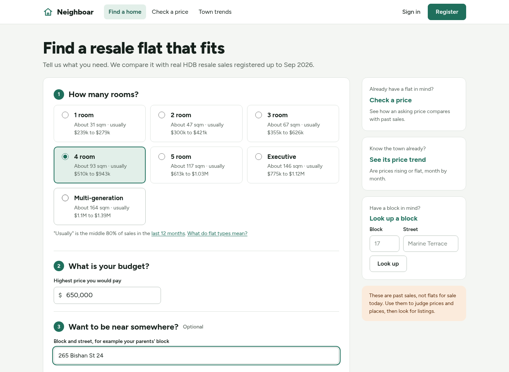

Answer three questions: the flat type (each shows its usual size and price range over the last 12 months), your highest price, and optionally a block you want to live near with a distance of 1, 2 or 5 km. Show what fits opens the results.

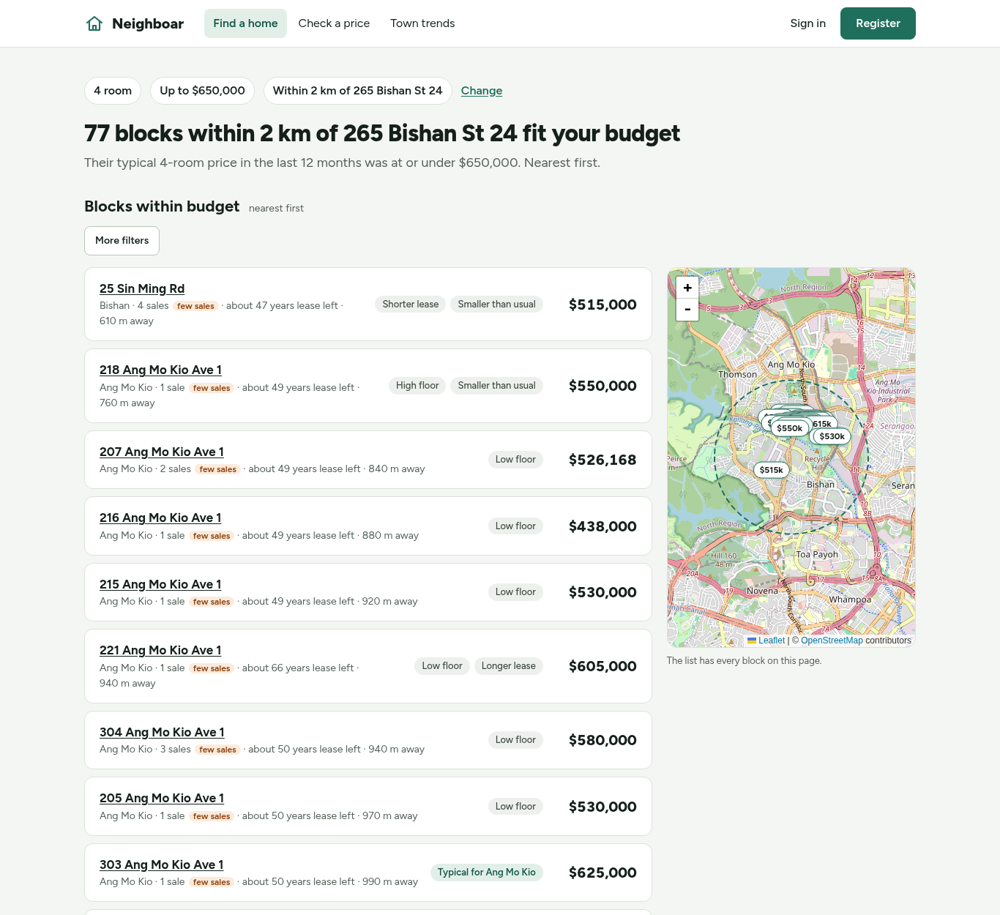

Without a place, the results list towns first, each with its typical price, number of sales and the share sold within budget, then the blocks whose typical recent price fits, cheapest first. With a place, they list the blocks within the distance, nearest first. Each block shows tags that compare it with its town (for example Low floor or Shorter lease). More filters narrows the list by town, lease left and floor area. The map shows the blocks of the page; the list has every one of them, so nothing is lost if the map cannot load.

### 7.2 A block's profile

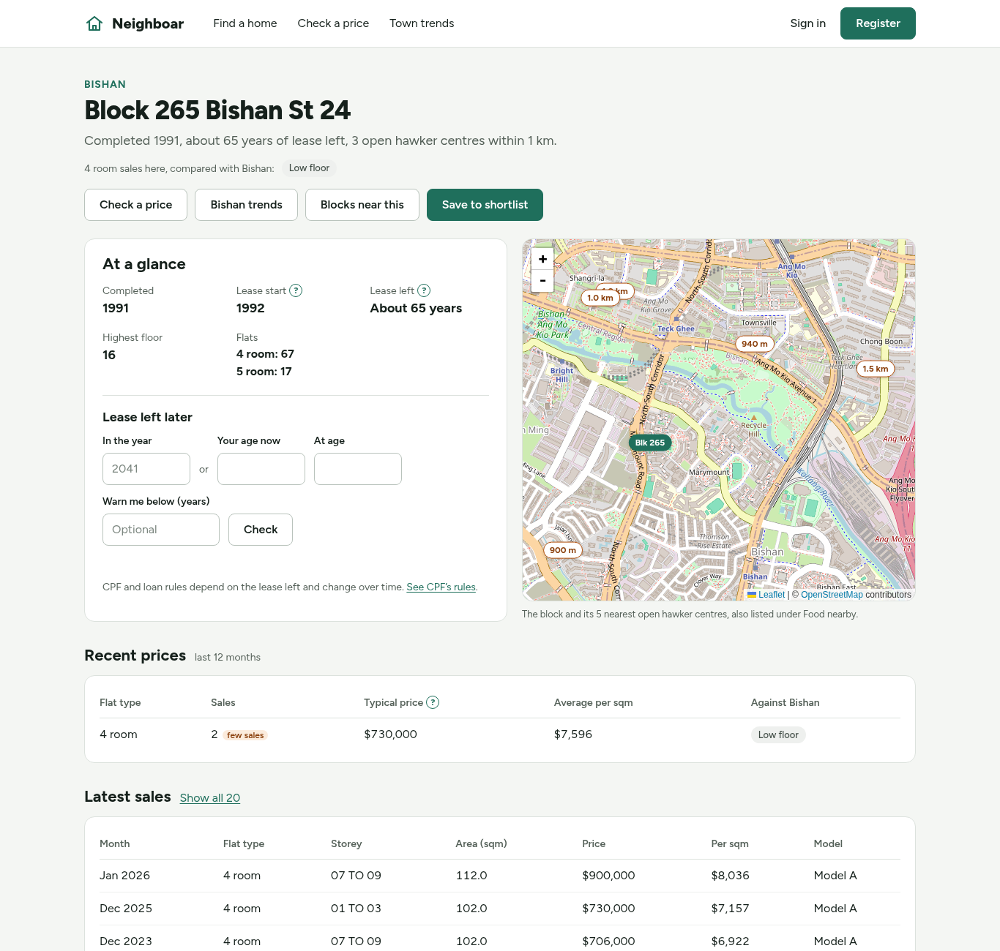

Click any block to open its profile: when it was completed, the lease left, its flats, and how its recent sales compare with the town. Lease left later works out the lease in a future year or at an age you type, which matters for CPF and loans. Below are the recent prices by flat type, the latest sales, the five nearest hawker centres (also on the map) and Save to shortlist. To find a block directly, use Look up a block on the home page.

### 7.3 Check a price

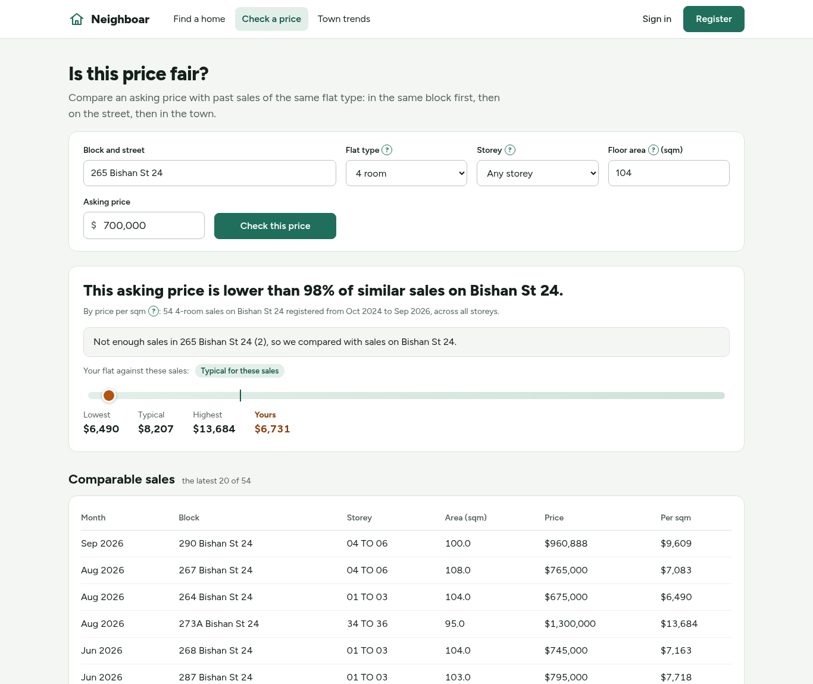

Enter the block, flat type, floor area and asking price, and optionally the storey. Neighboar compares the price per square metre with sales of the same flat type in the last 24 months: in the same block first, then on the same street, then in the town, whichever first has at least 5 sales. The bar shows the lowest, typical and highest of those sales and where your price falls; the table lists them.

### 7.4 Town trends

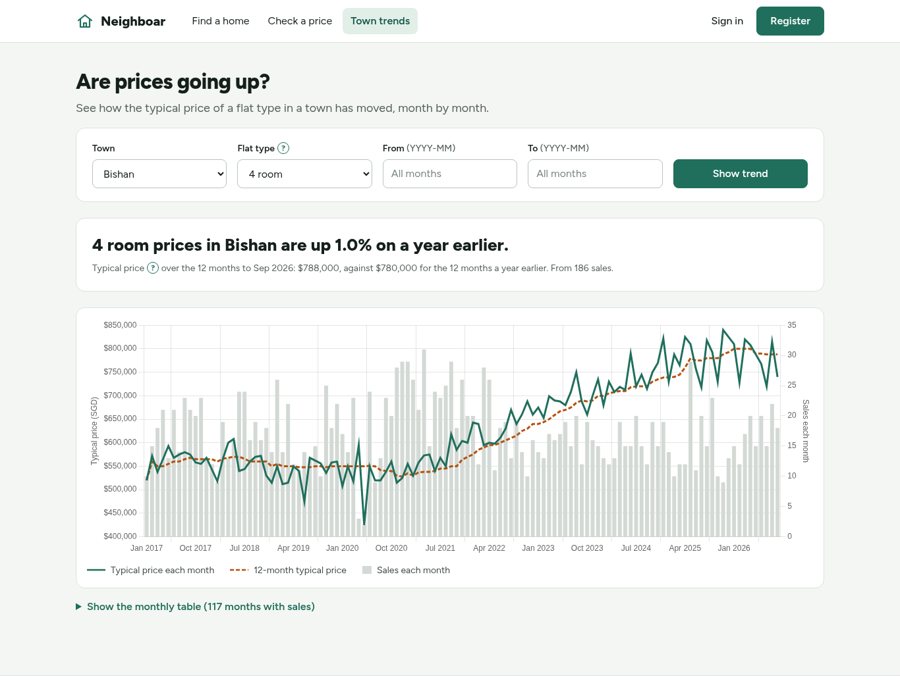

Choose a town and flat type, and optionally a range of months. The summary compares the last 12 months with the 12 before; the chart shows the typical price each month, the 12-month typical price (dashed) and the number of sales. Show the monthly table gives every month's figures.

### 7.5 Sign in, shortlist and compare

Register with an email and a password of 10 to 128 characters (Register, top right), then sign in. On a block's profile, Save to shortlist adds it with an optional note. A shortlist holds up to 50 blocks.

Tick 2 to 4 blocks on the shortlist and choose Compare selected to see them side by side for one flat type. "Lowest", "Longest" and "Most" mark the leader of a row; they are not a recommendation.

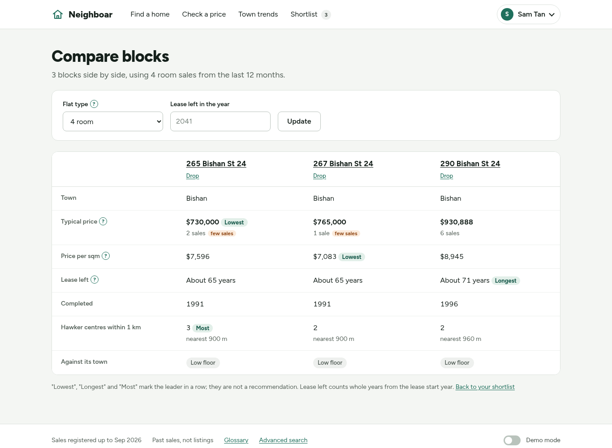

### 7.6 Share a shortlist with your partner

Under Household (account menu), invite your partner by the email of their account. They see the invitation on their shortlist page and choose whether their own saved blocks join the shared list.

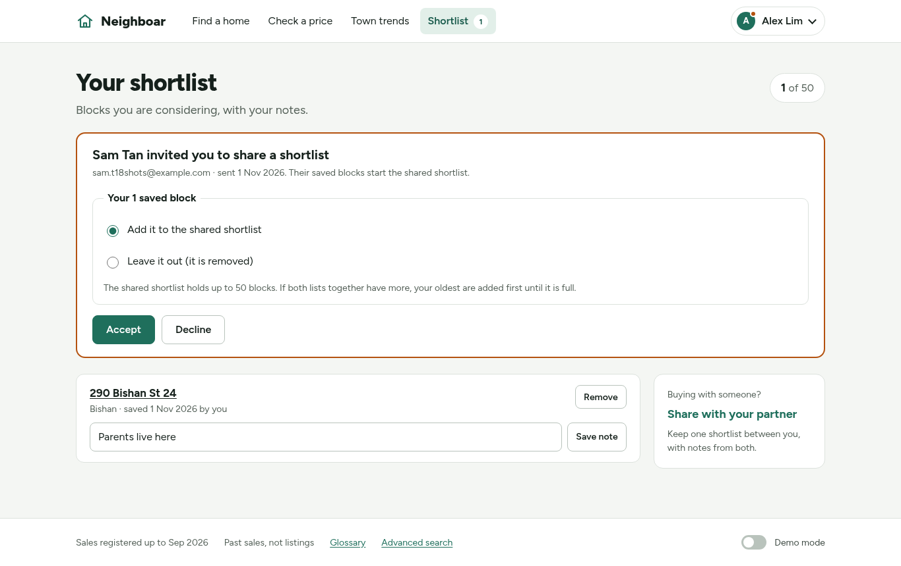

After they accept, you both see and change one shared shortlist; each block and note says who added it.

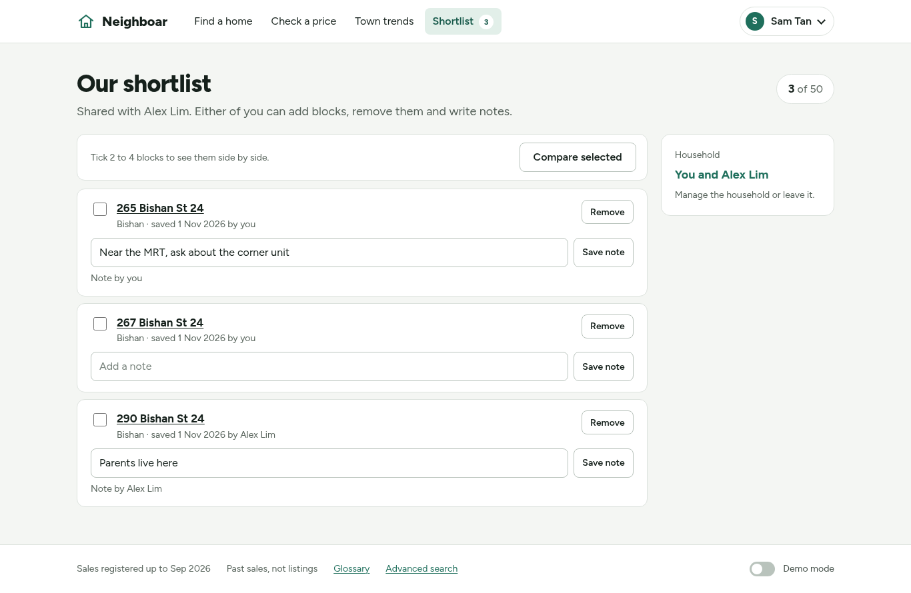

A household has two people. Either can leave it from the Household page: the other keeps the shortlist and its notes, and the one who leaves starts with an empty one.

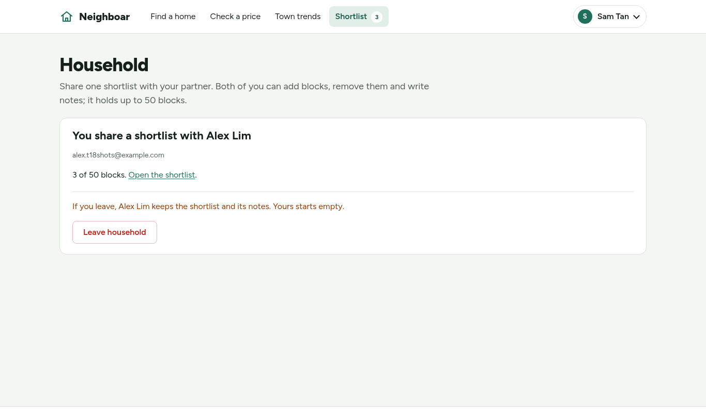

### 7.7 Your account

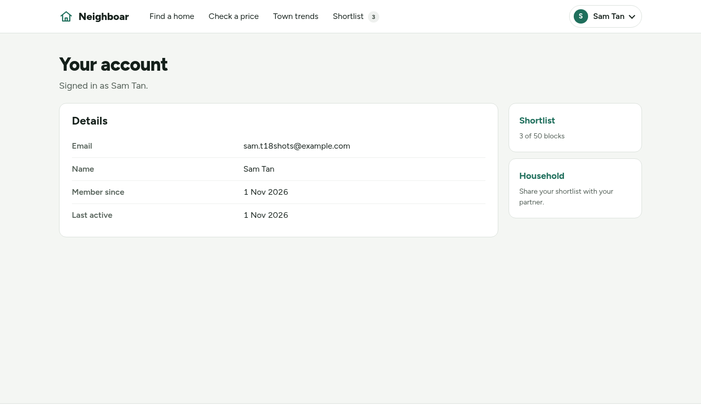

Your account shows your email, name, when you joined and when you were last active, with links to your shortlist and household.

### 7.8 Admin

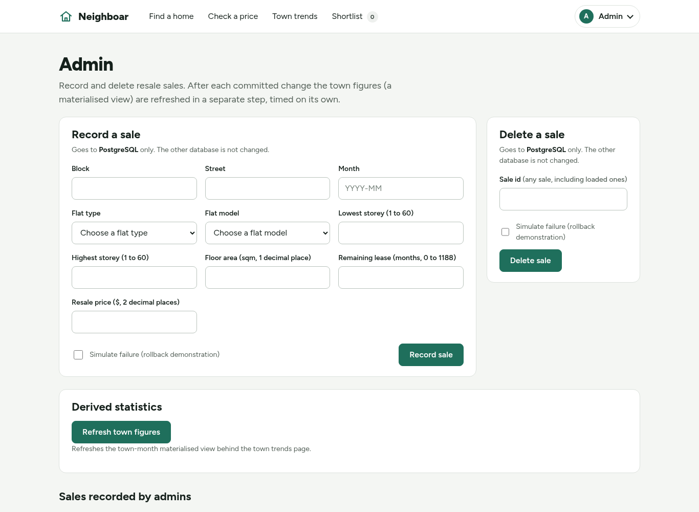

Administrators (section 8) open Admin from the account menu. Record a sale adds a resale sale and Delete a sale removes one by its id. Each form says which database it writes to. Simulate failure makes the write fail just before it commits, to show that the whole change is rolled back and nothing is left half done. In PostgreSQL the town figures are refreshed in a separate step after each change, and Refresh town figures runs that step again by hand; in MongoDB the block's figures are updated in the same transaction.

### 7.9 Demo mode: compare the two databases

Neighboar stores everything in both PostgreSQL and MongoDB, and each page can be answered by either. Buyers always use PostgreSQL. For a presentation, turn on Demo mode with the switch at the bottom right of every page.

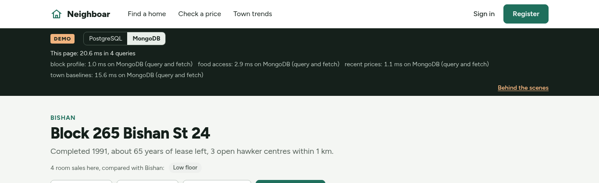

The dark demo bar then appears under the top bar. Switch between PostgreSQL and MongoDB there: the page reloads from the database you choose, with the same answer, and the bar lists every query the page ran with its time. Your choice follows you from page to page. Accounts, shortlists and households are stored separately in each database, so in demo mode you sign in to the database you have chosen, and switching shows that database's own shortlist.

Behind the scenes (link in the demo bar) shows both databases' health, the queries of the last page you opened with the SQL or MongoDB command behind each one (Show the query plans adds their plans), and the results of the latest formal benchmark with its charts.

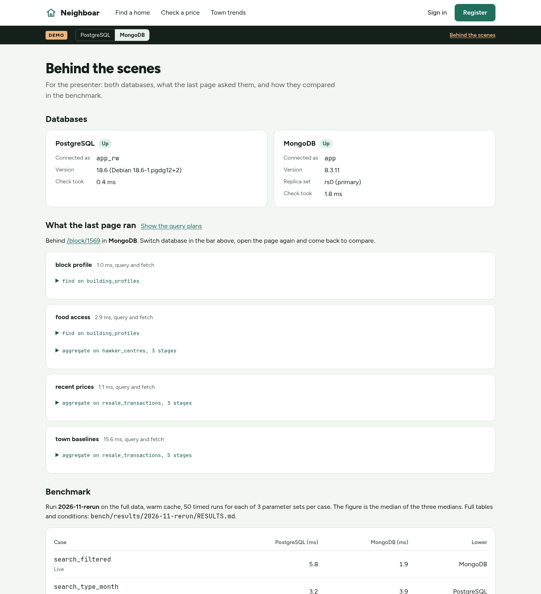

### 7.10 On a phone

Every page works at phone width. Wide tables become one card per row, and the menu shortens its labels when you are signed in.

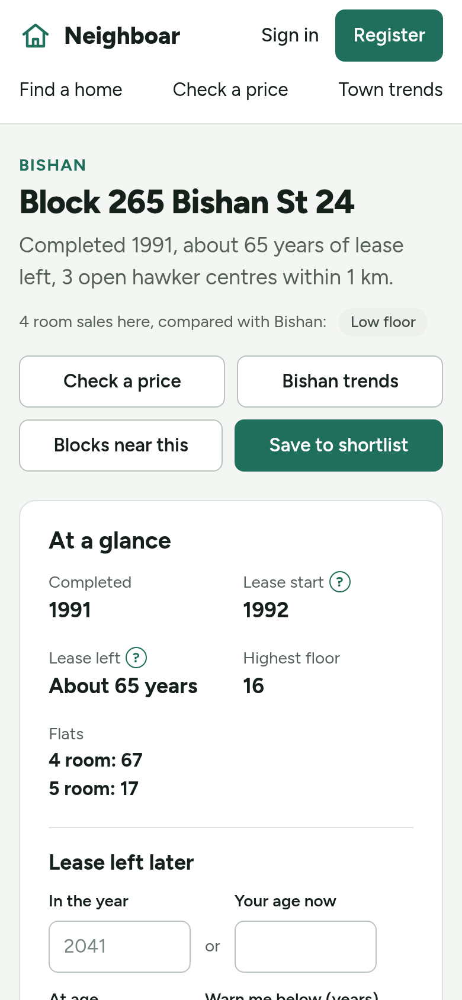

## 8. Demo accounts and the admin page

Two accounts are created by the load, in both databases:

| Account | Email | Role | Password |
| --- | --- | --- | --- |
| Buyer | `demo@neighboar.local` | normal user | your `DEMO_BUYER_PASSWORD` |
| Administrator | `admin@neighboar.local` | administrator | your `DEMO_ADMIN_PASSWORD` |

Use Sign in at the top right. Signed in as the administrator, Admin in the account menu opens the admin page (section 7.8). A sale recorded in one database is not copied to the other, so in demo mode the two give different answers for that block until you reload the data.

The load also writes 198 other synthetic buyers, ten households and five open invitations, so the shortlist and household pages have realistic data in both databases. These synthetic buyers cannot be signed in to.

## 9. Run the tests

With the stack up and the full data loaded. Run the tests straight after a load: signing in, saving buildings or recording sales writes to the database of the DB mode you are in only, by design, so the equivalence tests would then report the difference (for example, signing in as a demo account in PostgreSQL mode changes `last_active_at` in PostgreSQL only). If you have used the app since the load, the first command below reloads the data, which resets the demo accounts and the synthetic data.

```bash
docker compose run --rm etl
set -a; . ./.env; set +a
docker compose run --rm --no-deps -e NEIGHBOAR_URL=http://web:8000 -e PG_APP_RO_PASSWORD -e PG_OWNER_PASSWORD -e MONGO_ETL_PASSWORD -e DEMO_BUYER_PASSWORD -e DEMO_ADMIN_PASSWORD web python -m pytest -q -m "integration or not integration"
```

This runs the unit tests and the integration tests against your running databases. The demo passwords are given to the test container only. Every test passes, and a few are skipped on the full data because they check facts that only hold on the committed sample. A skip is not a failure. It takes from a few seconds to a few minutes depending on the machine. The tests that write data use their own records and clean them up.

## 10. Back up and restore

```bash
sh scripts/backup.sh --stop-web
sh scripts/restore.sh backups/<UTC timestamp>
```

The first command stops the web app, writes a dated folder under `backups/` (for example `backups/20261101T093000Z`) and starts the app again. The second command checks the folder, asks you to type `yes`, replaces both databases with the backup, compares them with the backup's fingerprint and starts the app again. Use the folder name that `backup.sh` printed.

A restore replaces everything in both databases, including accounts created since the backup. `sh scripts/check_backup_roundtrip.sh` does a whole back up, change and restore as a self-test.

Warning: `backups/` holds full copies of both databases, including the password hashes of every account. Do not share it, email it, commit it or put it in a zip. It is git-ignored and Docker-ignored on purpose.

Both scripts run the database tools in Docker and use your user id (`id -u`), which they set themselves. Nothing extra is required in Git Bash. On Linux, run them as your normal user, not with `sudo`, so the backup files belong to you.

## 11. Run a short benchmark

```bash
sh bench/run.sh --label demo --cases search_filtered --runs 3 --warmup 1
```

This times one query case, 3 runs after 1 warm-up, in PostgreSQL and in MongoDB. Before it times anything it checks that both databases give the same answer, and it stops with a message if they do not. It prints a `done:` line when it finishes and writes the results under `bench/results/demo/`. Three runs are only a demonstration of the tool, not a result. Run it again with the same label only with `--replace`, or choose another label. The full procedure used for the report is in `bench/README.md`. You can delete `bench/results/demo/` afterwards.

`bench/run.sh` needs the stack up and the full data loaded (step 6). On the sample it refuses with exit status 2, because it expects the full data's row count. On a laptop it also refuses on battery, because a laptop saving power runs slower by varying amounts; plug it in. It sets `HOST_UID` and `HOST_GID` itself.

## 12. Stop, restart and reset

```bash
docker compose stop          # stop everything, keep the data
docker compose up -d --wait web   # start again, no rebuild
docker compose down          # remove containers, keep the data (named volumes)
docker compose down -v       # also DELETE both databases (volumes pgdata and mongodata)
```

After `down -v`, repeat step 4 and step 6.

## 13. Troubleshooting

**MongoDB does not start on a new Linux kernel (6.19 or newer).** MongoDB 8.3.11 has been reported to fail to start on Linux kernel 6.19 and newer (MongoDB bug SERVER-121912). It did start and run normally on the project's Linux machine with kernel 7.2.8, so not every newer kernel is affected. The `mongodb` container exits or keeps restarting and `web` never becomes healthy. Check with `uname -r` on Linux, or `wsl uname -r` on Windows (Docker Desktop's WSL kernel was 6.18 when this was written and will reach 6.19 in time). `docker compose logs mongodb` shows the failure. The project pins the image version for fair comparisons, so there is no switch in `.env`; ask the team, who will choose a patched MongoDB version. Until then, use a machine or WSL kernel below 6.19. The project's CI runs on Ubuntu 22.04 for this reason.

**Port 8000 is already in use.** `docker compose up` reports "port is already allocated" or "address already in use". Another program, or an earlier copy of this stack, holds the port.

- Find the other copy: `docker ps` and look for a container publishing `127.0.0.1:8000`; stop it with `docker stop <name>`.
- Otherwise find the program using the port: in Git Bash on Windows, `netstat -ano | grep :8000`, then close that program in Task Manager (or run `taskkill //PID <pid> //F`). On Linux or macOS, `lsof -i :8000`.
- To use another port without finding it, change the web service's `ports:` line in `compose.yaml` from `"127.0.0.1:8000:8000"` to `"127.0.0.1:8001:8000"` and open http://localhost:8001/. Do not commit that change.

**`migrate` fails with "changed after it was applied" (old volumes).** On 22 October 2026 a comment inside `db/postgres/001_schema.sql` was changed (commit 10d8943). A PostgreSQL volume that was migrated before that date records the old checksum, so `migrate` refuses to continue and `web` never starts. The change was a comment only, and no user data existed then, so the recovery is to delete the volumes and start again.

Warning: this deletes both databases of this stack, including any accounts, saved buildings and admin sales in them. There is no supported way to keep that data: `scripts/backup.sh` cannot run while `migrate` fails, and `restore.sh` refuses a backup taken with different `db/postgres/*.sql` files. Run:

```bash
docker compose down -v
docker compose up -d --build --wait web
docker compose run --rm etl
```

`down -v` removes only the volumes of this Compose project (`neighboar_pgdata` and `neighboar_mongodata`), not other projects on your machine.

**`.env` mistakes.** `web` exits at once with "SECRET_KEY must be set to a random value of at least 32 characters": the value is missing, shorter than 32 or starts with `change-me`. The ETL stops before cleaning if a demo password is missing, shorter than 10 characters or starts with `change-me`. If you change a database password in `.env` after the first start, the old password is still stored in the volume; either change it back or reset with `docker compose down -v`.

**Out of memory.** Containers killed with exit code 137, or the load stopping part-way, mean Docker has too little memory. Raise it (step 1) and try again.

**A command fails with a path such as `C:/Program Files/Git/...` on Windows.** Git Bash rewrites some paths. Prefix the command with `MSYS_NO_PATHCONV=1`. The project's own scripts already do this.

## 14. Notes by platform

**Windows (Docker Desktop, Git Bash).** This is the main tested setup. Keep the clone on a normal Windows drive. Line endings: the repository uses LF; if Git has converted shell scripts to CRLF (`sh` reports `\r` errors), run `git config core.autocrlf false`, delete the clone and clone again.

**macOS.** Docker Desktop works as on Windows; use Terminal instead of Git Bash and set the memory as in step 1. On Apple Silicon (M1 or later) the images run natively as arm64, with these notes:

- The `dbtools` image (backup and restore) uses the Ubuntu 22.04 arm64 build of the MongoDB Database Tools, because MongoDB publishes no Debian 12 arm64 build. It has not been tested on arm64. If `sh scripts/backup.sh` fails there, report it with the output; the rest of the stack does not depend on it.
- Timings from the benchmark on a different machine are not comparable with the report's figures.

**Linux.** Tested on one machine: an Arch-based distribution with kernel 7.2.8 and Docker Engine with the Compose plugin, where the full load, the test suite and the formal benchmark run in `bench/results/2026-11-rerun/` all ran. Install Docker Engine and the Compose plugin and add your user to the `docker` group (`sudo usermod -aG docker $USER`, then log out and in) so you do not need `sudo`. Do not run the project's scripts with `sudo`, or the files in `backups/` and `bench/results/` become owned by root. Check your kernel with `uname -r` (see the MongoDB note in step 13).

The `etl` service writes its cleaned files to `data/interim/` in the bind-mounted `./data`, but runs as the image's user (id 10001), which cannot write a folder that belongs to you. The load stops with "Permission denied: '/srv/neighboar/data/interim'". Run every `etl` command as yourself instead, by adding `--user "$(id -u):$(id -g)"` after `run --rm`:

```bash
docker compose run --rm --user "$(id -u):$(id -g)" etl
docker compose run --rm --user "$(id -u):$(id -g)" etl python -m etl.download
```

Docker Desktop on Windows and macOS does not need this, because it maps file ownership itself. `bench/run.sh`, `scripts/backup.sh` and `scripts/restore.sh` already run as your user.
